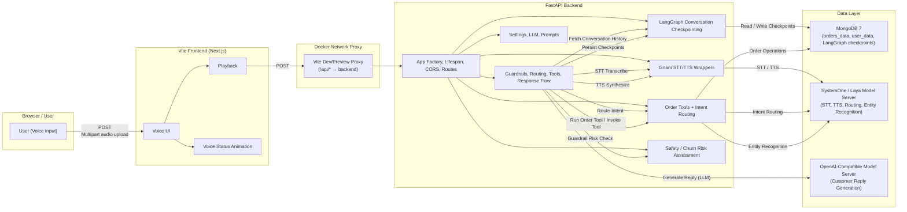
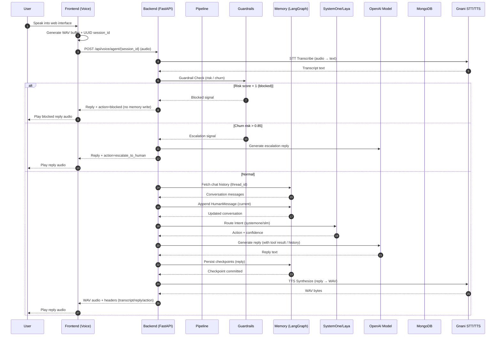
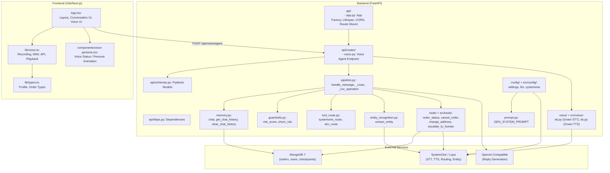
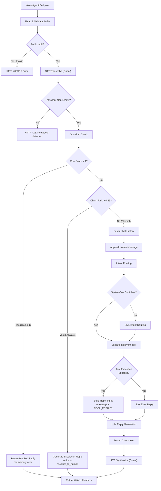
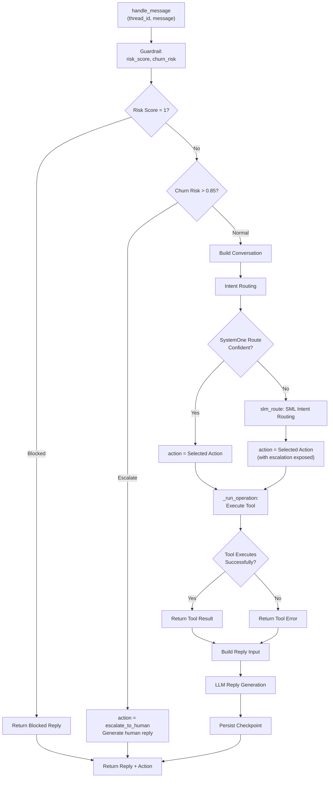

# SystemOne Assistant — Architecture Diagram

**SystemOne Assistant** is a voice-first customer support application for an online store.
Users speak into a web interface, the backend transcribes audio, routes the request,
performs order operations, generates a response, and returns synthesized WAV audio
for browser playback.

---

## 1. High-Level Architecture

---

## 2. Data Flow Diagram

---

## 3. Component Responsibility Diagram

---

## 4. Pipeline Processing Flow

---

## 5. Routing & Tool Decision Flow

---

## 6. Service Stack & Dependency Summary

| Layer | Component | Technology | Responsibility |
|-------|-----------|------------|----------------|
| **Client** | Browser / Vite Frontend | React 19, Next.js, TailwindCSS, WAV codec | Voice input, recording, WAV conversion, playback, conversation UI |
| **Backend** | FastAPI | Python 3.12, FastAPI, Uvicorn, LangGraph | API routing, pipeline orchestration, safety & routing |
| **Orchestration** | LangGraph | LangGraph, MongoDB Checkpoints | Conversation state management, checkpoint persistence |
| **Safety** | Guardrails | SystemOne/Noul | Risk & churn assessment, content blocking |
| **Routing** | SystemOne / Laya | SystemOne / Laya | Intent routing, entity recognition |
| **Generation** | OpenAI-Compatible | OpenAI-compatible API | Customer reply generation |
| **Voice** | Gnani STT/TTS | Gnani API | Audio transcription & synthesis |
| **Storage** | MongoDB | MongoDB 7.0 | Order/user data, conversation checkpoints |
| **Docker** | docker-compose | Docker Compose | Full-stack orchestration & deployment |

---

## 7. API Endpoint Summary

| Method | Endpoint | Purpose |
|-------|----------|---------|
| `GET` | `/api/health` | Backend health check |
| `GET` | `/api/profile` | Current user profile |
| `GET` | `/api/orders` | Current user's orders |
| `GET` | `/api/orders/{order_id}` | Single order detail |
| `POST` | `/api/voice/agent/{session_id}` | Audio turn: STT → pipeline → TTS (returns WAV audio + headers) |